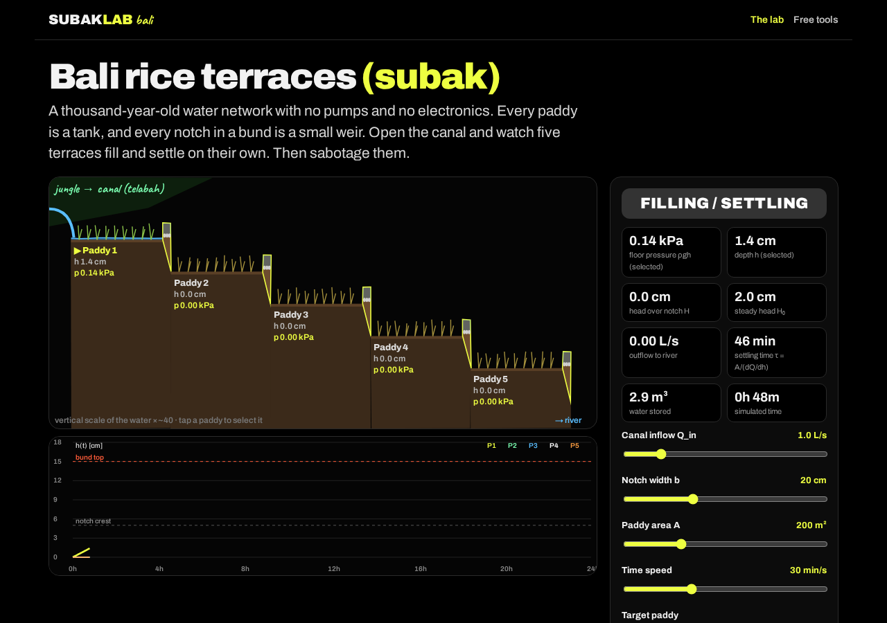

# Subak Lab Bali · rice-terrace hydraulics

**Live:** https://andreolf.github.io/subak-lab/

A free, no-sign-up interactive lab of a Balinese rice-terrace (subak) cascade, built from terraces Francesco Andreoli photographed in Bali. Five paddies, five notches, zero pumps: open the canal and watch the paddies fill and settle at ~7 cm of water (≈ 0.69 kPa floor pressure). Then sabotage it: **block a notch**, **remove the stones** from a notch so it erodes, or **open the tembuku** divider and give part of the water away.

By Francesco Andreoli, mechanical engineer (ETH Zurich alumnus) · YouTube [@swissintech](https://www.youtube.com/@swissintech) · X [@francescoswiss](https://x.com/francescoswiss)

> **Honest disclaimer.** This is a simplified, educational model: every paddy is a well-mixed tank, there is a single weir coefficient, an invented erosion law, and areas/widths/crest heights are estimates. It's great for intuition about weirs, mass balance and hydrostatics, not for designing real irrigation. Real subak water is also governed by water temples and farmer cooperatives, which no equation captures. The [free tools page](https://andreolf.github.io/subak-lab/tools.html) shows how to build a serious model for $0.



## Run locally
Requires Node 18+. The site itself has zero runtime dependencies; Playwright is only used for tests.
```bash
npm run build          # src/ -> dist/ (inlines partials, copies assets)
npm run preview        # serves dist/ on http://localhost:4173
npm run dev            # build + preview
```

## Test
```bash
npm i && npx playwright install chromium
npm run test:e2e       # Playwright: desktop 1280 + mobile 390, no console errors, assets load; writes screenshots/
npm run test:pages     # same suite, served under /subak-lab/ exactly like GitHub Pages
npm run test:live      # same suite against https://andreolf.github.io/subak-lab/ (screenshots/live-*.png)
```

## Deploy
GitHub Pages serves the `gh-pages` branch, which holds the contents of `dist/` plus a `.nojekyll`. All asset paths are relative, so the site works under the project subpath.
```bash
npm run build
git fetch origin gh-pages && git worktree add ../subak-lab-gh-pages gh-pages
rsync -a --delete --exclude .git dist/ ../subak-lab-gh-pages/ && touch ../subak-lab-gh-pages/.nojekyll
cd ../subak-lab-gh-pages && git add -A && git commit -m "deploy" && git push origin gh-pages
cd - && git worktree remove ../subak-lab-gh-pages
```

## Stack
Plain HTML / CSS / vanilla JS (ES modules) + Canvas 2D. No framework, no runtime dependencies, no tracking, no external requests (fonts are self-hosted subsets of Archivo and Caveat, both SIL OFL). Zero-dependency Node build (`build.mjs`) and preview server (`serve.mjs`); Playwright for end-to-end tests.

## License
[MIT](LICENSE) © 2026 Francesco Andreoli. Fonts: Archivo and Caveat under the SIL Open Font License.

## Layout
- `src/index.html`: the lab (landing page); `src/tools.html`: free tools + a path to a real model
- `src/partials/`: `head`, `nav`, `footer` inlined by the build
- `src/js/subak-core.js`: 5-paddy weir cascade, mass balance and erosion (pure, also runs in Node)
- `src/js/subak.js`: rendering and UI; `src/js/sketch.js`: hand-drawn canvas helpers
- `test/e2e.mjs`: Playwright checks; `test/static-server.mjs`: test server (optionally under a subpath)

## The model (educational approximation)
Broad-crested notch weirs Q = C b √g H^1.5 with C = (2/3)^1.5 ≈ 0.544; per-paddy mass balance A dh/dt = Q_in − Q_out − A(E + q) with evaporation E = 5 mm/day and percolation q = 1.5 mm/day; bund overtopping along √A; a tembuku proportional split at the head; and a toy crest-erosion law (critical-flow velocity vs 0.25 m/s for bare soil, 1.5 m/s with stone armour). Defaults: A = 200 m², b = 20 cm, crest 5 cm, bund 15 cm, Q_in = 1 L/s, giving a settling time τ ≈ 45 min.

Also by the same author: [Coconut Lab, the coconut that never escapes](https://andreolf.github.io/coconut-lab/).
